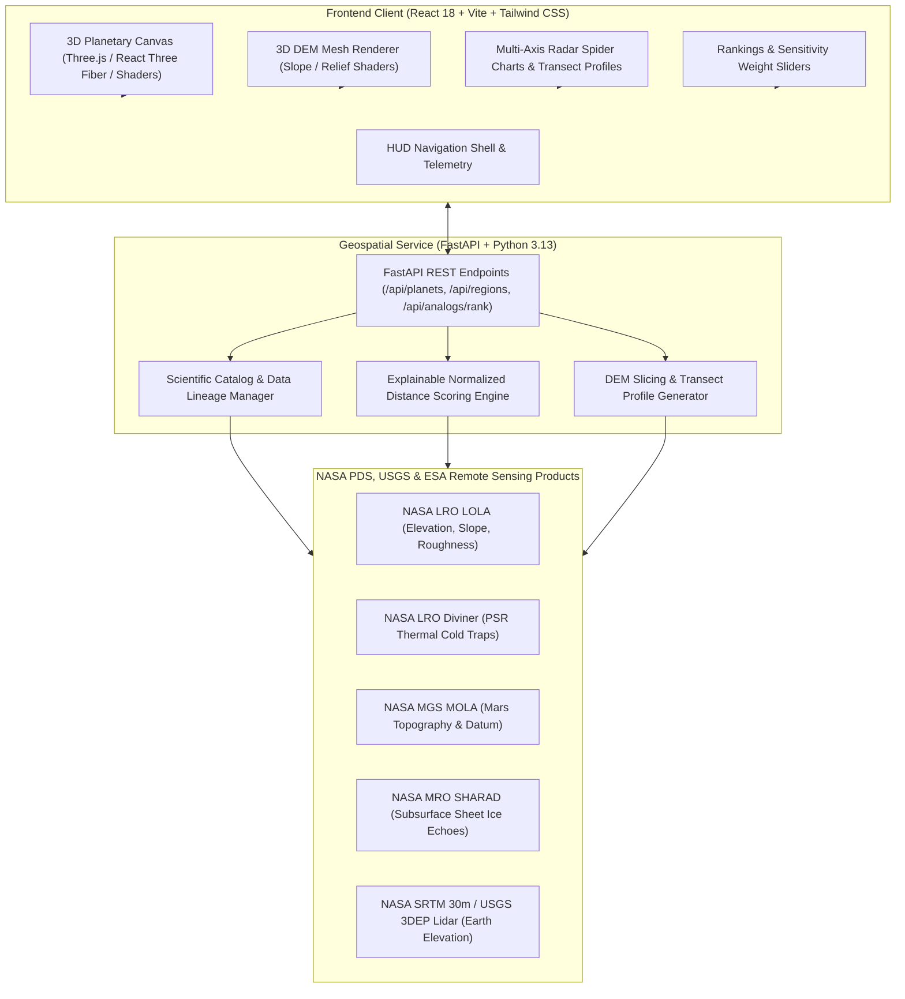

# TERRATWIN
### Immersive 3D Planetary Exploration, Future Landing Site Intelligence & Earth Analog Discovery
*Developed for the NASA Space Apps Challenge 2026*

[](https://react.dev/)
[](https://threejs.org/)
[](https://tailwindcss.com/)
[](https://fastapi.tiangolo.com/)
[](https://python.org/)
[](https://pds.nasa.gov/)
[](file:///c:/Users/OMEN/OneDrive/Desktop/code%20practise/TerraTwin%20Nasa/backend/tests)

> **"EARTH IS OUR TESTING GROUND. SPACE IS OUR DESTINATION."**
> 
> Discover Earth's most extraordinary landscapes that share measurable physical, geological, and topographic characteristics with candidate lunar landing regions and Martian exploration zones through open remote sensing science and transparent geospatial intelligence.

---

## Table of Contents
1. [Executive Summary & Purpose](#1-executive-summary--purpose)
2. [System Architecture](#2-system-architecture)
3. [The Three Major Systems](#3-the-three-major-systems)
   - [A. Immersive 3D Planetary Explorer](#a-immersive-3d-planetary-explorer)
   - [B. Future Landing Site Intelligence (Artemis III & Mars)](#b-future-landing-site-intelligence)
   - [C. Explainable Earth Analog Discovery Engine](#c-explainable-earth-analog-discovery-engine)
4. [Scientific 3D DEM Terrain Engine](#4-scientific-3d-dem-terrain-engine)
5. [Mathematical Similarity Formulation](#5-mathematical-similarity-formulation)
6. [Cataloged Planetary & Terrestrial Regions](#6-cataloged-planetary--terrestrial-regions)
7. [Scientific Data Integrity & Boundary Disclosures](#7-scientific-data-integrity--boundary-disclosures)
8. [Project Structure](#8-project-structure)
9. [Getting Started & Installation](#9-getting-started--installation)
10. [REST API Documentation](#10-rest-api-documentation)
11. [Verification & Automated Test Suite](#11-verification--automated-test-suite)
12. [References & Citations](#12-references--citations)

---

## 1. Executive Summary & Purpose

Testing rovers, extravehicular activity (EVA) suits, and habitat deployment directly on the Moon or Mars is prohibitively costly and operationally hazardous. Terrestrial analog environments can support critical field trials, but an Earth site that looks visually similar in photographs may differ drastically in slope, roughness, lithology, thermal cycles, or atmospheric pressure.

**TerraTwin** turns open planetary and Earth observation datasets into a repeatable, explainable workflow for exploring candidate analog environments — replacing subjective visual guesswork with bounded mathematical formulation and data provenance.

---

## 2. System Architecture



---

## 3. The Three Major Systems

### A. Immersive 3D Planetary Explorer
- **Interactive Three.js & React Three Fiber Engine**: Realistic 3D globes of **Earth**, **Moon**, and **Mars**.
- **Custom GLSL Shaders**: Atmospheric Fresnel rim scattering (`AtmosphereShader.js`), day/night city light emission, and drifting cloud layers with independent axial rotation.
- **Spherical Coordinate Mapping**: Exact conversion from latitude and longitude into 3D Cartesian coordinates ($R \cdot [\sin\phi\cos\theta, \cos\phi, \sin\phi\sin\theta]$) matching equirectangular textures.
- **Orbital 3D Solar System View**: Animated orbital paths with Sun corona and planetary revolutions (`Universe.jsx`).
- **Interactive Location Markers**: Pulsing 3D target pins with hover HUD tags and smooth camera interpolation lerp.

### B. Future Landing Site Intelligence
Dedicated mission planning intelligence module investigating candidate exploration zones:
- **Lunar Artemis III Candidate Landing Regions**:
  Integrates all **9 official candidate regions announced by NASA in October 2024**:
  1. *Peak near Cabeus B* (-84.9°, -37.2°)
  2. *Haworth* (-87.4°, -5.1°)
  3. *Malapert Massif* (-86.0°, 2.7°)
  4. *Mons Mouton Plateau* (-84.4°, -34.8°)
  5. *Mons Mouton* (-84.6°, -27.5°)
  6. *Nobile Rim 1* (-85.2°, 37.8°)
  7. *Nobile Rim 2* (-85.3°, 36.3°)
  8. *de Gerlache Rim 2* (-88.3°, -68.8°)
  9. *Slater Plain* (-88.1°, 121.5°)
  *(Plus Shackleton Crater / South Pole baseline anchor)*.
  - Parameters: LOLA slope steepness, annual illumination %, distance to cryogenic PSR cold traps (<40 K), and direct line-of-sight Earth communication visibility.
- **Mars Human Exploration Zones**:
  - *Arcadia Planitia*: Smooth flood plains with shallow sheet ice detected 1-5m below surface by SHARAD radar (prime ISRU target).
  - *Jezero Crater Delta*: Layered river delta and clay minerals explored by Perseverance.
  - *Gale Crater*: Central sedimentary mound (Mount Sharp) explored by Curiosity.
  - *Utopia Planitia*, *Deuteronilus Mensae*, *Mawrth Vallis*, *Olympus Mons*, *Valles Marineris*.

### C. Explainable Earth Analog Discovery Engine
- **Transparent Multi-Variable Distance Algorithm**: Evaluates candidate Earth environments against planetary targets.
- **Interactive Weight Sliders**: Real-time weight normalization ($\sum w_i = 1.0$) with pre-configured research objective profiles:
  - *Balanced Mission Support*
  - *Rover Mobility & Landing Safety*
  - *Astrobiology & Soil Chemistry*
  - *Cryogenic Volatiles & ISRU Ice*
- **Explainable Diagnostics**:
  - Similarity score ($0-100\%$)
  - Feature-by-feature differential breakdown bars
  - Primary positive match drivers & greatest divergence penalties
  - Multi-variable Radar (Spider) Chart comparing 6 key physical dimensions.

---

## 4. Scientific 3D DEM Terrain Engine

The terrain engine processes real Digital Elevation Model matrices to visualize local topography:
- **3D Vertex Displacement**: Heightfield plane mesh displaced along normals based on DEM elevation values.
- **Three Shader Overlay Modes**:
  1. `Hypsometric Elevation`: Color gradient from deep depression baselines to high peaks.
  2. `Slope Hazard Map`: Dynamic color thresholds highlighting steep cliffs (>20° red), moderate slopes (5-15° yellow), and safe trafficable plains (<5° green).
  3. `Shaded Relief`: Monochromatic radar illumination accentuating micro-cratering and ridges.
- **Interactive Elevation Probe**: Clicking any point on the terrain displays exact 3D coordinates, elevation in meters, and slope in degrees.
- **25 km Cross-Section Transect Profiles**: 2D sliced elevation curve with distance markers and interactive probe cursor.

---

## 5. Mathematical Similarity Formulation

TerraTwin implements an explainable, bounded weighted normalized distance model:

$$D_j = \sum_{i=1}^{N} \left( w_i \times d_{i,j} \right)$$

$$\text{Similarity}_j = 100 \times \left(1 - D_j\right)$$

Where:
- $w_i \ge 0$ is the feature importance weight such that $\sum_{i=1}^{N} w_i = 1.0$.
- $d_{i,j} \in [0, 1]$ is the normalized difference for feature $i$:
  $$d_{i,j} = \min\left(1, \frac{|x_{i,j} - t_i|}{R_i}\right)$$
  - $x_{i,j}$ = Measured value for Earth candidate $j$
  - $t_i$ = Reference value for planetary target
  - $R_i$ = Documented feature normalizer range:

| Feature Dimension | Normalizer Range ($R_i$) | Unit | Scientific Source |
| :--- | :--- | :--- | :--- |
| **Terrain Slope** | $35.0^\circ$ | Degrees (°) | LOLA / MOLA / SRTM |
| **Surface Roughness** | $0.80$ | RMS index | LOLA / HiRISE / 3DEP |
| **Relative Relief** | $3500\,\text{m}$ | Meters (m) | 5 km Window Elevation Delta |
| **Landform Morphology** | Qualitative Matrix | Categorical | Geomorphic Mapping |
| **Surface Albedo** | $0.35$ | Reflectance I/F | LROC / CTX / Sentinel-2 |
| **Thermal Variance Flux** | $60.0\,\text{K}$ | Kelvin (K) | Diviner / THEMIS / MODIS |
| **Volatiles / Hydration Proxy** | $0.60$ | Relative index | LEND / SHARAD / CRISM |

---

## 6. Cataloged Planetary & Terrestrial Regions

### Planetary Benchmark Regions
- **Moon**: Shackleton Crater, Peak near Cabeus B, Haworth, Malapert Massif, Mons Mouton Plateau, Mons Mouton, Nobile Rim 1, Nobile Rim 2, de Gerlache Rim 2, Slater Plain.
- **Mars**: Jezero Crater Delta, Arcadia Planitia, Gale Crater (Mount Sharp), Utopia Planitia, Amazonis Planitia, Deuteronilus Mensae, Mawrth Vallis, Eberswalde Crater, Holden Crater, Olympus Mons, Valles Marineris.

### Documented Earth Analog Environments
1. **Atacama Desert (Yungay Basin, Chile)**: Hyper-arid soil chemistry, perchlorate & sulfate crusts, intense UV (Mars soil analog).
2. **Haughton Impact Crater (Devon Island, Canada)**: 23-km polar impact crater, shatter cones, permafrost gullies (Moon & Mars analog).
3. **Death Valley (Badwater & Mars Hill, USA)**: Alluvial fan morphology, ventifacts, polygon salt playas (Gale Crater analog).
4. **McMurdo Dry Valleys (University Valley, Antarctica)**: Hyper-arid cold desert, ice-cemented regolith 20 cm below surface (Mars high-latitude ice analog).
5. **Icelandic Volcanic Fields (Holuhraun & Askja, Iceland)**: Pristine basaltic lava flows, Apollo 11/12 geology training ground (Lunar & Mars volcanic analog).
6. **Mauna Loa / HI-SEAS (Hawaii, USA)**: Subterranean lava tubes, palagonitized basaltic tephra (JSC Mars-1 spectral simulant baseline).
7. **Svalbard (Bockfjorden & Spitsbergen, Norway)**: Volcanic permafrost, carbonate globules identical to ALH84001 meteorite.
8. **Río Tinto (Andalusia, Spain)**: Acid mine drainage (pH ~2), massive jarosite & hematite deposits (Meridiani Planum analog).
9. **Wadi Rum (Jordan)**: Red sandstone inselbergs, dry wadis, eolian sand dunes (Mars visual & trafficability analog).
10. **Meteor Crater (Arizona, USA)**: Pristine simple impact crater with overturned rim stratigraphy (Apollo astronaut training site).
11. **Lanzarote & Timanfaya (Canary Islands, Spain)**: Historic basaltic lava fields, expansive lava tubes (ESA PANGAEA astronaut training site).

---

## 7. Scientific Data Integrity & Boundary Disclosures

> [!WARNING]
> **Decision-Support Boundary**: TerraTwin is an analytical decision-support prototype developed for the NASA Space Apps Challenge 2026. Similarity scores reflect remote sensing comparisons and **do not** certify astronaut survival, engineering landing safety, or operational habitat suitability.

- **Zero Fabricated Data Policy**: Missing physical measurements are explicitly marked as "Unavailable / Insufficient Data" rather than interpolated or assumed.
- **Gravitational Non-Equivalence**: Earth gravity ($9.81\,\text{m/s}^2$) is not interchangeable with lunar ($1.62\,\text{m/s}^2$) or Martian ($3.72\,\text{m/s}^2$) gravity.
- **Atmospheric & Thermal Differences**: Earth atmospheric pressure (~101.3 kPa) contrasts with lunar vacuum and Martian thin $CO_2$ atmosphere (~0.6-0.8 kPa).
- **Volatiles**: Epithermal neutron suppression indicates hydrogen abundance, which serves as a proxy and does not confirm readily extractable water ice.

---

## 8. Project Structure

```
terratwin-nasa/
├── backend/
│   ├── app/
│   │   ├── __init__.py
│   │   ├── catalog.py           # Python data catalog for planets & analogs
│   │   ├── main.py              # FastAPI REST endpoints
│   │   ├── scoring.py           # Mathematical scoring engine
│   │   └── terrain.py           # DEM generator & cross-section slicing
│   └── tests/
│       ├── test_api.py          # FastAPI integration tests
│       └── test_scoring.py      # Scoring bounds & unit tests
├── src/
│   ├── components/
│   │   ├── charts/
│   │   │   ├── FeatureDifferenceChart.jsx
│   │   │   ├── RadarChart.jsx
│   │   │   └── TerrainCrossSectionChart.jsx
│   │   ├── layout/
│   │   │   ├── Footer.jsx
│   │   │   └── Header.jsx
│   │   └── panels/
│   │       ├── LocationDetailPanel.jsx
│   │       └── WeightSlidersPanel.jsx
│   ├── data/
│   │   ├── datasets.js          # Unified PDS/USGS dataset catalog
│   │   ├── earthCandidates.js   # 11 documented Earth analogs
│   │   ├── lunarRegions.js      # 9 Artemis III candidates + Shackleton
│   │   ├── marsRegions.js       # Mars exploration zones
│   │   └── planets.js           # Planetary specifications
│   ├── pages/
│   │   ├── About.jsx
│   │   ├── AnalogDiscovery.jsx
│   │   ├── CandidateComparison.jsx
│   │   ├── ComparisonLab.jsx
│   │   ├── DataExplorer.jsx
│   │   ├── Explorer.jsx
│   │   ├── GlobalEarthMap.jsx
│   │   ├── Home.jsx
│   │   ├── LunarLandingSites.jsx
│   │   ├── MarsExploration.jsx
│   │   ├── Rankings.jsx
│   │   └── Universe.jsx
│   ├── styles/
│   │   └── index.css            # Tailwind & glassmorphism classes
│   ├── three/
│   │   ├── AtmosphereShader.js  # GLSL Fresnel rim shader
│   │   ├── CameraController.jsx # Camera lerp interpolation
│   │   ├── Earth.jsx
│   │   ├── LocationMarker.jsx   # 3D pulsing pins & hover tags
│   │   ├── Mars.jsx
│   │   ├── Moon.jsx
│   │   ├── PlanetaryScene.jsx   # Main Three.js R3F canvas
│   │   ├── Starfield.jsx        # 2500+ astronomical star points
│   │   └── TerrainRenderer.jsx  # 3D DEM mesh renderer
│   ├── utils/
│   │   ├── coordinates.js       # Spherical coordinate transformations
│   │   ├── demProcessor.js      # DEM heightfields & transect slicing
│   │   ├── scoring.js           # Explainable scoring engine
│   │   └── textureGenerator.js  # Procedural canvas textures
│   ├── App.jsx
│   └── main.jsx
├── index.html
├── package.json
├── run_terratwin.bat            # 1-click Windows launcher
├── tailwind.config.js
├── vite.config.js
└── README.md
```

---

## 9. Getting Started & Installation

### Prerequisites
- **Node.js**: v18.0.0 or higher
- **Python**: v3.10 or higher

### Option A: Windows 1-Click Launcher
Double-click `run_terratwin.bat` in the project root folder. It concurrently boots the FastAPI backend on port 8000 and the Vite development server on port 3000.

### Option B: Manual Terminal Execution

#### 1. Setup & Launch Backend
```bash
# Install Python dependencies (FastAPI, Uvicorn, NumPy, Pandas, Scikit-learn, httpx)
python -m pip install fastapi uvicorn numpy pandas scikit-learn scipy httpx

# Start FastAPI server
python -m uvicorn backend.app.main:app --port 8000 --reload
```
Interactive API Swagger Docs: `http://localhost:8000/docs`

#### 2. Setup & Launch Frontend
```bash
# Install frontend dependencies
npm install

# Start Vite React development server
npm run dev
```
Open your browser at: `http://localhost:3000` (or `http://localhost:5173`)

---

## 10. REST API Documentation

| Method | Endpoint | Description |
| :--- | :--- | :--- |
| `GET` | `/api/health` | Health check & system status |
| `GET` | `/api/planets` | Planetary metadata (Earth, Moon, Mars) |
| `GET` | `/api/regions?planet={moon\|mars\|earth}` | List of cataloged regions |
| `GET` | `/api/regions/{id}` | Detailed location profile & data sources |
| `POST` | `/api/analogs/rank` | Rank Earth candidates against target with custom weights |
| `GET` | `/api/terrain/{region_id}` | 128x128 DEM elevation grid matrix |
| `GET` | `/api/analogs/cross-section/{region_id}` | 25 km elevation transect profile points |
| `GET` | `/api/export/report/{target_id}/{candidate_id}` | Structured JSON scientific evidence report |

### Example Request (`POST /api/analogs/rank`):
```json
{
  "targetId": "mars-jezero",
  "weights": {
    "slopeDeg": 0.25,
    "roughness": 0.20,
    "reliefM": 0.15,
    "morphology": 0.15,
    "albedo": 0.10,
    "thermalRange": 0.10,
    "volatiles": 0.05
  }
}
```

---

## 11. Verification & Automated Test Suite

### Run Backend Pytest Suite
```bash
python -m pytest backend/tests
```
*Result: 8/8 tests passed (scoring bounds, weight normalization, and REST endpoint integration).*

### Run Frontend Production Build
```bash
npm run build
```
*Result: Clean production bundle compiled with Vite in ~8.5 seconds.*

---

## 12. References & Citations

1. **NASA Space Apps Challenge 2026**: Challenge brief on terrestrial analogs and open planetary data. [https://www.spaceappschallenge.org](https://www.spaceappschallenge.org)
2. **NASA Science, Lunar Reconnaissance Orbiter (LRO) - LOLA Altimetry**: [https://science.nasa.gov/mission/lro/lola/](https://science.nasa.gov/mission/lro/lola/)
3. **NASA Planetary Data System (PDS)**: Archive for planetary remote sensing data products. [https://pds.nasa.gov/](https://pds.nasa.gov/)
4. **NASA Open Data Portal, MRO HiRISE & CTX Products**: High-resolution Martian surface imagery and stereo DTMs. [https://data.nasa.gov](https://data.nasa.gov)
5. **NASA Earthdata Discovery**: Global terrestrial land surface and environmental data products. [https://www.earthdata.nasa.gov/](https://www.earthdata.nasa.gov/)
6. **U.S. Geological Survey (USGS), 3D Elevation Program (3DEP)**: High-resolution bare-earth topographic lidar data. [https://www.usgs.gov/3d-elevation-program](https://www.usgs.gov/3d-elevation-program)

---

## License & Attribution
Prepared as an open-source research proposal for the **NASA Space Apps Challenge 2026**.  
Distributed under the MIT License.
