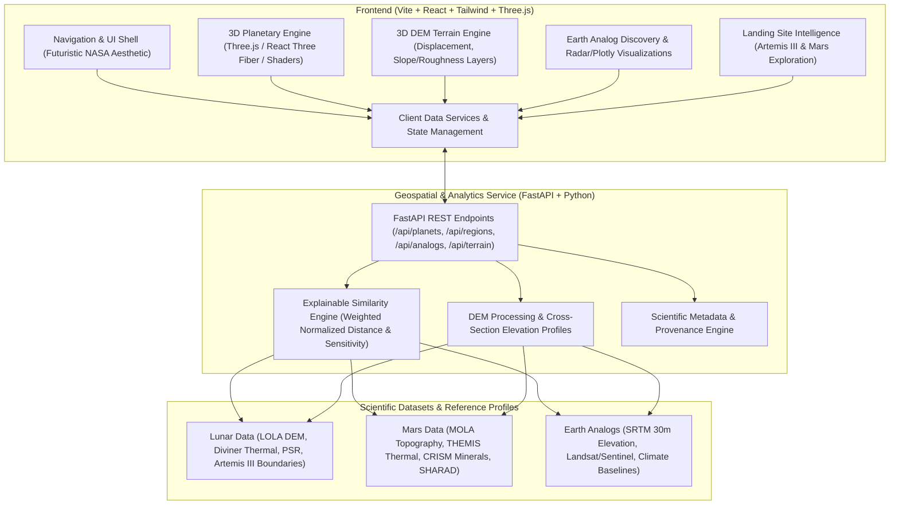

# TerraTwin: Immersive 3D Planetary Exploration & Earth Analog Discovery Platform

## Executive Summary & Objective

TerraTwin is a production-quality planetary exploration and geospatial intelligence web application built for researchers, mission planners, robotics teams, and educators. It unifies three core capabilities:
1. **Immersive 3D Planetary Exploration**: High-fidelity, interactive 3D globes of Earth, Moon, and Mars rendered using Three.js and React Three Fiber with custom GLSL shaders (atmospheric scattering, day/night lighting, cloud dynamics, and realistic elevation-displacement geometry).
2. **Future Landing Site Intelligence**: In-depth scientific analysis of NASA's 9 Artemis III candidate lunar landing regions (announced October 2024), Shackleton Crater / Lunar South Pole, and candidate Mars human exploration zones (Jezero, Gale, Arcadia Planitia, Utopia Planitia, Mawrth Vallis, etc.) integrating real data from LRO (LOLA, LROC, Diviner, LEND) and Mars orbiters (MOLA, HiRISE, CTX, THEMIS, CRISM, SHARAD).
3. **Explainable Earth Analog Discovery Engine**: A data-driven analytical engine using a bounded, explainable weighted normalized distance metric to evaluate and rank Earth analog environments (e.g., Atacama Desert, Haughton Crater, McMurdo Dry Valleys, Icelandic volcanic fields, Death Valley) against planetary reference regions, complete with feature contribution breakdown, sensitivity analysis, and explicit data quality/uncertainty indicators.

---

## User Review Required

> [!IMPORTANT]
> **Architecture & Execution Strategy**: Following Section 19 and 21 of the specification, the application will be built incrementally across 8 coordinated phases. We will establish the complete Vite + React 18 + Tailwind CSS + Three.js / R3F frontend coupled with a high-performance Python FastAPI geospatial backend.

> [!NOTE]
> **Data Integrity and Provenance Policy**: In strict adherence to scientific integrity principles (Section 18), all physical parameters (slope, roughness, elevation relief, surface temperature, albedo, volatile/hydration proxies) are grounded in published datasets from NASA PDS, USGS, LOLA, MOLA, and SRTM. Datasets with incomplete coverage will display explicit "Unavailable / Insufficient Data" indicators rather than fabricated estimates.

---

## Technical Stack & System Architecture

### Frontend Specifications
- **Framework**: React 18+ with Vite (blazing fast HMR, modern ES modules)
- **Styling**: Tailwind CSS with custom deep-space theme (`#030712`, `#0a1128`, `#00f2fe`, `#4facfe`, cyan accents, glassmorphic HUDs, glowing borders)
- **3D Visualization**: Three.js, `@react-three/fiber`, `@react-three/drei`, custom GLSL vertex and fragment shaders for planetary atmospheres, fresnel rim lighting, and elevation heightmaps
- **Icons & Motion**: Lucide React icons, Framer Motion for sleek HUD transitions
- **Scientific Charting**: Recharts and custom interactive SVG/Canvas charts for radar profiles, terrain cross-sections, and feature-difference bar charts
- **GIS / Mapping**: Interactive Leaflet / MapLibre-ready 2D analog map with coordinate reprojection and synchronized 3D planetary markers

### Backend Specifications
- **Server Framework**: FastAPI + Uvicorn
- **Data Science & Geospatial**: NumPy, Pandas, Scikit-learn, SciPy
- **Terrain Processing**: High-efficiency array-based DEM slicing, normal-vector derivation, slope and roughness calculation, elevation profile cross-sections
- **REST Endpoints**:
  - `GET /api/health`
  - `GET /api/planets`
  - `GET /api/regions?planet={planet}&category={category}`
  - `GET /api/regions/{id}`
  - `GET /api/datasets`
  - `GET /api/terrain/{region_id}` (heightmap grid array, bounding box, elevation range)
  - `POST /api/analogs/rank` (payload: target reference ID, feature weights, min coverage threshold)
  - `POST /api/analogs/cross-section` (payload: coordinates or line path, returns sampled elevation curve)
  - `GET /api/export/report/{region_id}` (generates structured research summary)

---

## Scientific Similarity & Mathematical Formulation

The similarity engine follows the exact formulation specified in Section 10 and the TerraTwin project proposal:

### 1. Distance Metric
For each candidate Earth region $j$ compared to planetary reference $T$:
$$D_j = \sum_{i=1}^{N} \left( w_i \times d_{i,j} \right)$$
$$\text{Similarity}_j = 100 \times \left(1 - D_j\right)$$

Where:
- $w_i \ge 0$ is the importance weight of feature $i$, normalized such that $\sum_{i=1}^{N} w_i = 1$.
- $d_{i,j} \in [0, 1]$ is the normalized difference for feature $i$:
  $$d_{i,j} = \min\left(1, \frac{|x_{i,j} - t_i|}{R_i}\right)$$
  - $x_{i,j}$ = Earth candidate value for feature $i$
  - $t_i$ = Planetary reference value for feature $i$
  - $R_i$ = Scientifically documented feature normalizer range (e.g., slope $R=45^\circ$, roughness $R=1.0$, relief $R=3000\,\text{m}$, thermal range $R=80\,\text{K}$)

### 2. Feature Dimensions
1. **Terrain Slope**: Mean steepness derived from LOLA / MOLA / SRTM digital elevation products (degrees).
2. **Surface Roughness**: Local Hurst exponent / RMS surface deviation at decameter to hectometer scales.
3. **Relative Relief**: Elevation range ($\Delta h$) within a standardized 5 km kernel window (meters).
4. **Landform Morphology**: Geomorphic classification (crater rims, basaltic volcanic plain, alluvial fan, lava tube/collapse, sand dune/yardang).
5. **Surface Albedo / Reflectance**: Standardized hemispherical reflectance.
6. **Thermal Variance**: Temperature fluctuation range over diurnal/seasonal cycles.
7. **Geological / Substrate Match**: Lithology (basaltic silicate, anorthositic regolith, impact melt/breccia, evaporite, permafrost).
8. **Volatiles / Hydration Proxy**: Spectroscopic absorption indicators (1.9/2.2 $\mu\text{m}$ for Mars/Earth clays, neutron epithermal hydrogen suppression for lunar/Martian ice proxies).

### 3. Data Quality & Coverage Handling
- **Coverage Index**: $C_j = \frac{N_{\text{available}}}{N_{\text{total}}}$.
- If $C_j < \text{threshold}$ (default 60%), the candidate is flagged with an explicit warning or excluded from definitive ranking to avoid false positive matches due to missing variables.
- Sensitivity variance is computed by perturbing weights by $\pm 20\%$ to quantify ranking stability.

---

## Proposed Phased Implementation

### Phase 1: Frontend Foundation & Project Architecture
- Scaffold Vite + React app with Tailwind CSS configuration, typography, and theme variables.
- Build root layouts, futuristic NASA-style navigation HUD (`Header`, `Sidebar`, `Footer`, `Breadcrumbs`).
- Implement the immersive Landing Page with animated starfield, headline *"EARTH IS OUR TESTING GROUND. SPACE IS OUR DESTINATION"*, dynamic call-to-action cards, and mission overview.
- Setup client routing for all 12 target views: Home, 3D Universe, Explorer, Mission Planning (Lunar Sites & Mars Zones), Candidate Comparison, Analog Discovery, Comparison Lab, Rankings, Data Explorer, About.

### Phase 2: 3D Planetary Engine (Earth, Moon, Mars)
- Build core Three.js / React Three Fiber canvas (`PlanetaryScene.jsx`, `Planet.jsx`, `CameraController.jsx`).
- Create high-resolution planetary spheres:
  - **Earth**: Day/night texture, clouds layer with independent axial rotation, GLSL atmospheric scattering fresnel shader.
  - **Moon**: Realistic lunar surface textures (LROC/LOLA), subtle roughness, crater shadow rendering.
  - **Mars**: Realistic oxidized surface textures, polar ice caps, Martian atmospheric thin haze shader.
- Implement camera controls: smooth orbit dragging, wheel zooming, reset camera button, smooth focus animations between planetary targets.

### Phase 3: Planetary Exploration & Geographic Coordinates
- Implement accurate spherical coordinate transformation utilities in `utils/coordinates.js`:
  - Convert $(\text{lat}, \text{lon})$ to $(x, y, z)$ on spherical meshes aligned with equirectangular texture mappings.
- Add interactive 3D location pins (`LocationMarker.jsx`) with glowing HUD pulses, hover tooltips, and click-to-focus camera interpolation.
- Build comprehensive planetary location databases:
  - Moon: Shackleton Crater, Malapert Massif, Mons Mouton, Haworth, Cabeus, Nobile, Mare Imbrium.
  - Mars: Jezero Crater, Gale Crater, Olympus Mons, Valles Marineris, Arcadia Planitia, Utopia Planitia, Mawrth Vallis, Holden, Eberswalde.
- Build glassmorphic Location Detail Drawer (`LocationDetailPanel.jsx`) displaying coordinates, elevation, slope, geology, and direct "Find Earth Analogs" and "Inspect 3D Terrain" actions.

### Phase 4: Mission Planning & Landing Site Intelligence
- Dedicated Artemis III Landing Site Explorer (`LunarLandingSites.jsx`):
  - Detailed profiles of NASA's 9 official Artemis III candidate regions.
  - Scientific instrument data toggles: LOLA altimetry, LEND hydrogen abundance, Diviner thermal maps, PSR distance.
- Dedicated Mars Future Human Exploration Explorer (`MarsExploration.jsx`):
  - Exploration zones categorized: robotic heritage sites, potential resource zones (shallow ice via SHARAD), scientific/astrobiology targets.
  - Instrument layers: MOLA, HiRISE, THEMIS, CRISM, MEDA/REMS environmental weather baselines.
- Candidate Comparison interface (`CandidateComparison.jsx`): side-by-side spec comparison of landing sites.

### Phase 5: Scientific 3D Terrain Engine
- Implement Digital Elevation Model (DEM) mesh renderer (`TerrainRenderer.jsx`):
  - Generate heightfield meshes from DEM elevation matrices.
  - Custom vertex shader displacing geometry along normal vectors based on height values.
  - Custom fragment shader for hypsometric elevation color ramps (LOLA grayscale/viridis, MOLA rainbow/spectral, Earth topological).
- Dynamic shader overlays: toggleable slope gradient maps and surface roughness heatmaps.
- Terrain Cross-Section elevation profile generator with interactive cursor slicing.

### Phase 6: Earth Analog Discovery Engine
- Build comprehensive Earth Candidate database (`earthCandidates.js`):
  - Atacama Desert (Chile), Haughton Crater (Canada), Death Valley (USA), McMurdo Dry Valleys (Antarctica), Icelandic Volcanic Fields, Kilauea/HI-SEAS (Hawaii), Svalbard (Norway), Rio Tinto (Spain), Wadi Rum (Jordan), Meteor Crater (Arizona), Lanzarote (Spain).
- Implement client and server similarity scoring algorithms (`utils/scoring.js` and `backend/app/scoring/`):
  - Configurable weight sliders for Slope, Roughness, Relief, Morphology, Albedo, Thermal, Geology, Volatiles.
  - Real-time ranking updates with similarity score ($0-100$), difference breakdowns, coverage indicators, and sensitivity indices.
- Global 3D Earth Analog Viewer (`GlobalEarthMap.jsx`):
  - Earth globe displaying color-coded analog markers ranked by similarity to the selected Moon/Mars target.

### Phase 7: Comparison Laboratory & Reporting
- Side-by-side scientific comparison laboratory (`ComparisonLab.jsx`):
  - Dual 3D viewports comparing planetary target vs. Earth analog.
  - Radar chart (spider diagram) comparing 6 physical parameters simultaneously.
  - Quantitative feature differential breakdown table with scientific units, instrument source, and resolution.
- Exportable scientific evidence report (`ReportModal.jsx` / printable/downloadable summary) adhering to NASA Space Apps presentation standards.

### Phase 8: FastAPI Backend & Verification
- Implement the FastAPI backend (`backend/app/main.py`):
  - Scientific dataset catalog with PDS/NASA Earthdata links and status indicators.
  - REST endpoints for ranking calculations, terrain elevation matrix streaming, and cross-section sampling.
- Comprehensive automated verification tests:
  - Unit tests for scoring math ($D \in [0, 1]$, edge cases, weight normalization).
  - Coordinate transformation tests (North pole, South pole, Prime meridian, Equator).
  - API endpoint integration tests.
  - Frontend production build verification (`npm run build`).

---

## Verification Plan

### Automated Verification
1. **Frontend Build & Linter**:
   - `npm run build`: Verify TypeScript/JSX bundling, Three.js shaders, Tailwind CSS asset compilation without errors.
2. **Scoring Engine Unit Tests**:
   - Run Python pytest suite in `backend/tests/test_scoring.py`:
     - Test identical profiles yield similarity = 100.
     - Test maximum deviation yields similarity = 0.
     - Test weight normalization and coverage penalty.
3. **Backend API Tests**:
   - Run pytest in `backend/tests/test_api.py` validating all REST endpoints respond with correct status codes and JSON schemas.

### Manual Verification
1. **Interactive 3D Navigation**:
   - Test rotation, zooming, planet switching (Earth $\to$ Moon $\to$ Mars), and camera reset.
   - Verify smooth camera lerp when clicking planetary markers.
2. **Landing Site Exploration**:
   - Open Artemis III candidate sites (e.g. Malapert Massif, Shackleton Crater) and verify LOLA, Diviner, and PSR measurements.
   - Open Mars exploration sites (e.g. Jezero, Arcadia Planitia) and inspect MOLA/SHARAD metrics.
3. **Earth Analog Workflow**:
   - Select Jezero Crater $\to$ Run Analog Discovery $\to$ Inspect ranked Earth analogs (Atacama, Death Valley, Haughton Crater).
   - Adjust feature weights $\to$ Observe real-time dynamic re-ranking and radar chart adaptation.
4. **3D Terrain DEM Engine**:
   - Open local 3D terrain viewer for Shackleton and Jezero $\to$ Toggle slope and elevation color ramps $\to$ Sliced cross-section curve updates.
5. **Responsiveness**:
   - Verify layout on Desktop, Laptop, and Tablet viewport dimensions.
